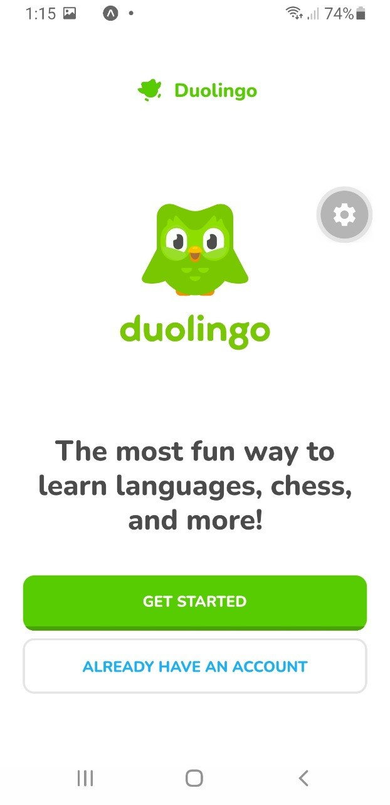
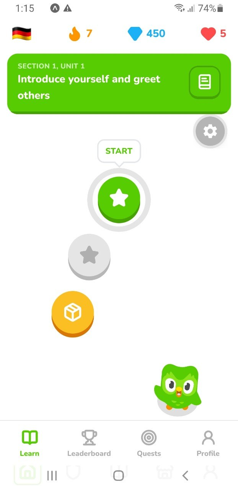
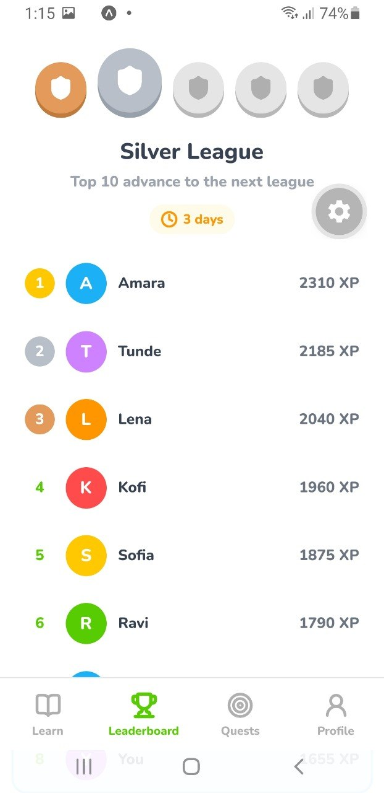

A language-learning app UI built with React Native, inspired by the gamified lesson-path style of popular learning apps. This is a **design and front-end practice project**: the screens are fully styled and animated, and the data is mocked for now.

> Not affiliated with, endorsed by, or connected to Duolingo. Built purely for learning and portfolio purposes.

## Screenshots

The app isn't published on the Play Store or App Store yet, so here's how it looks running.

| Onboarding | Learn | Leaderboard |
| :---: | :---: | :---: |
|  |  |  |

## Features

**Onboarding**
- Onboarding flow for new users before they reach the Learn screen

**Learn**
- Zigzag lesson path generated from data, one list of nodes per unit
- Lesson nodes with a 3D press effect: active, locked, chest, headphones and trophy variants
- Floating, bouncing "Start" label on the active lesson
- Fixed banner that changes color and text per unit as you scroll, with a smooth color tween and text fade
- Unit dividers and a Lottie mascot at each unit, configurable per unit
- Current unit detected from measured layout, not hardcoded scroll offsets

**Leaderboard**
- League header with earned, current and locked league badges
- Ranked player list with gold, silver and bronze medals
- Promotion and demotion zones, with dividers computed from the data
- Highlighted row for the current user

## Tech stack

- React Native
- TypeScript
- NativeWind (Tailwind CSS for React Native)
- lucide-react-native for icons
- lottie-react-native for mascot animations
- react-native-safe-area-context

## Project structure

```
assets/
  duo-waving.json            # mascot Lottie animation(s)
components/
  Lesson.tsx                 # lesson node (active, locked, chest, ...)
  UnitBanner.tsx             # animated fixed banner
  LearnTopBar.tsx
  BottomNavigation.tsx
  leaderboard/
    LeagueBadge.tsx
    LeagueHeader.tsx
    ZoneDivider.tsx
    Rank.tsx
    PlayerRow.tsx
utils/
  units.ts                   # unit colors, descriptions, path items
  leaderboard.ts             # mock leagues and players, getZone helper
docs/
  screenshots/               # images used in this README
```

## Getting started

```bash
# install dependencies
npm install

# start the dev server (adjust if you use a different workflow)
npx expo start
```

Then press `a` for an Android emulator, `i` for the iOS simulator, or scan the QR code with Expo Go on your phone.

## Customizing

- **Add a unit:** add an object to `utils/units.ts` with a color, description, mascot animation key and a list of path items.
- **Change the mascot per unit:** add a Lottie file under `assets/`, import it in the Learn screen, and map its key in `ANIMATIONS`.
- **Preview other leagues:** change `CURRENT_LEAGUE`, `PROMOTION_COUNT` and `DEMOTION_COUNT` in `utils/leaderboard.ts`.

## Roadmap

- [ ] Completed state and unit-colored nodes
- [ ] Progress ring on the active lesson
- [ ] Tooltip with a Start button when tapping a lesson
- [ ] Real lesson screen (questions, hearts, XP)
- [ ] Backend for progress and leaderboard data
- [ ] Quests, Shop and Profile screens

## Disclaimer

This project is for educational purposes only. All trademarks and brand names belong to their respective owners. Check the license of any third-party animation or asset before publishing.
